# Centrio Transfer Installation Guide

Centrio Transfer moves a Windows 10 or 11 PC to Oreon 10. It runs in Windows, copies the files you pick, and after they are copied and checked it deletes Windows and gives that space to your files.

Read the whole guide once before you start.

## 1. Before you start

- Back up anything important to a USB drive or cloud storage. Windows is deleted at the end.
- Plug in the charger and keep the PC plugged in until Oreon shows its login screen.
- Connect to the internet. The app downloads Oreon 10 (about 1.9 GB).
- Sign in to Windows with an administrator account.
- Write down any Wi-Fi passwords and app license keys you need.

## 2. What your PC needs

- Windows 10 version 2004 (build 19041) or newer, or Windows 11, 64-bit
- A processor that Oreon 10 supports. The app checks this for you.
- UEFI startup mode and a GPT disk. Legacy BIOS and MBR disks are refused.
- Disk storage mode set to AHCI, not RAID
- Enough free space on C: for Oreon plus the files you bring
- BitLocker can stay on until the BitLocker step. The app can turn it off for you.

## 3. Install the app

1. Copy `CentrioTransfer-1.0.0.msi` to the PC.
2. Double-click it and follow the installer.
3. Open Centrio Transfer from the Start menu. If Windows asks, choose Yes to run it as administrator.

## 4. Walk through the app

### Welcome

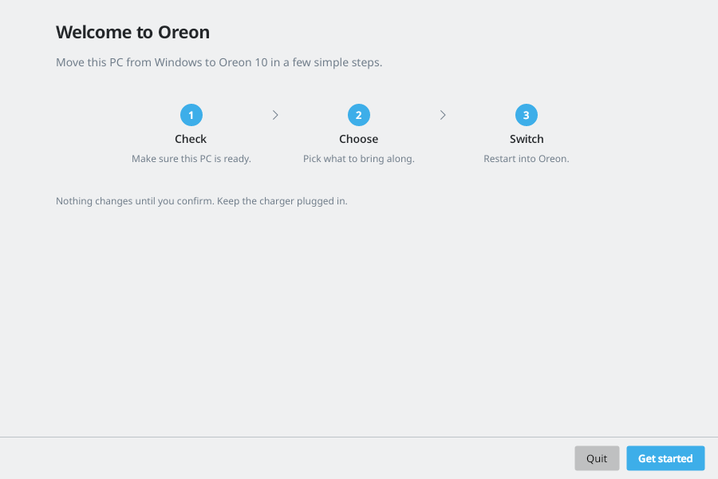

Click Get started. If an earlier run left changes on the PC, this page also offers Undo changes.

### What this does

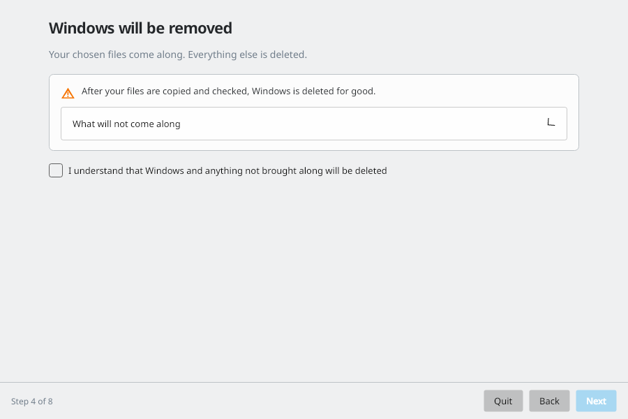

This page lists every step and the point of no return. Tick "I understand that Windows and anything not brought along will be deleted" to continue.

### Checks

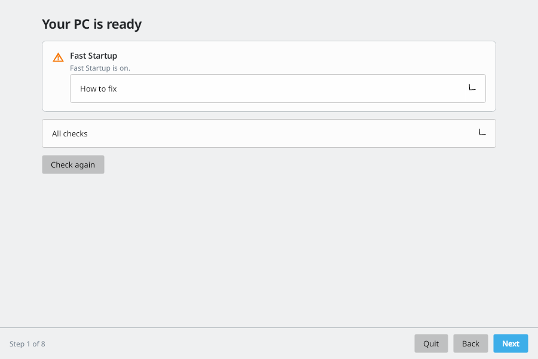

The app checks administrator rights, Windows version, processor, startup mode, disk layout, storage mode, Secure Boot, power, Fast Startup, BitLocker and drive health.

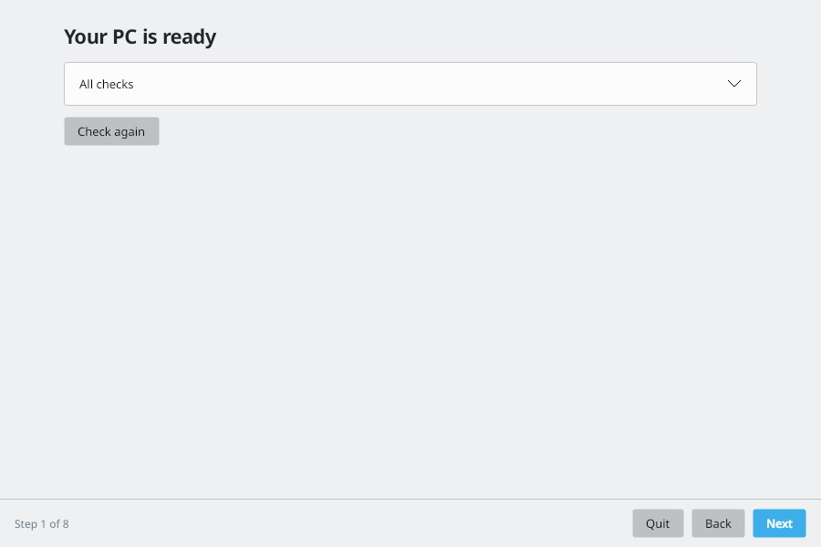

If something needs fixing, the page shows How to fix. For Fast Startup and drive health you can click Fix for me, then Check again.

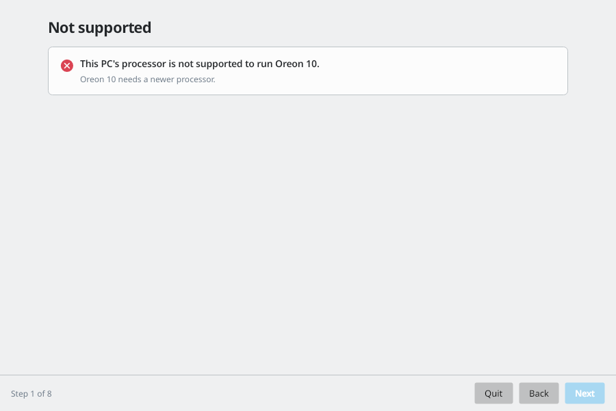

If the processor is not supported, the app stops here. Nothing has changed.

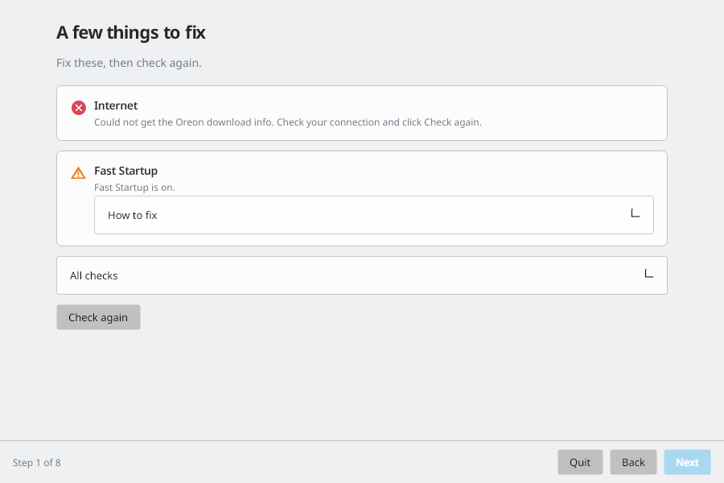

If the app cannot reach the download server, connect to the internet and click Check again.

### Choose a disk

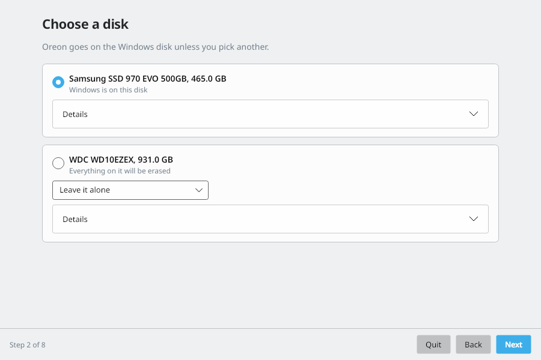

Oreon goes on the Windows disk unless you pick another. For each other disk choose Keep it and use it in Oreon, Leave it alone, or Everything on it will be erased. Disks in RAID mode cannot be used.

### Choose what to bring

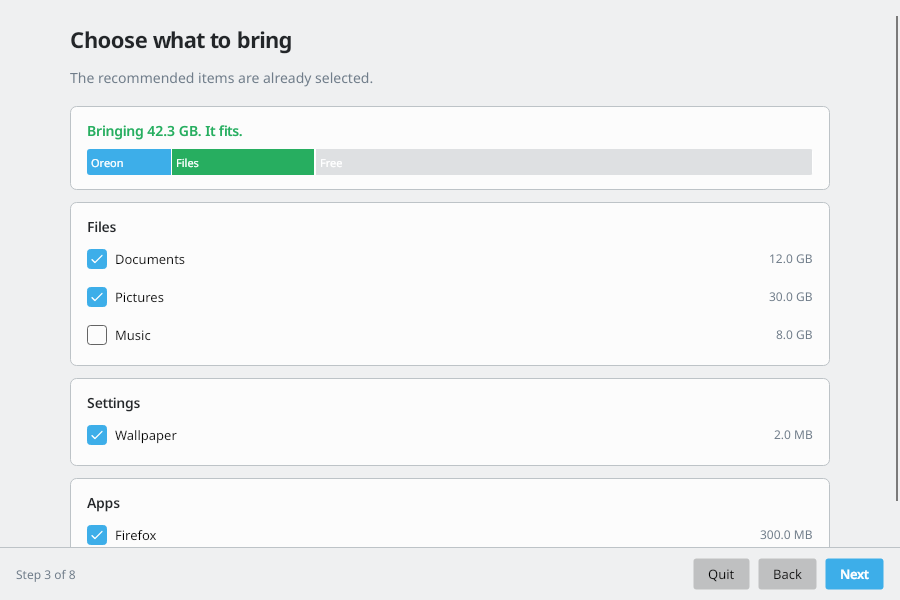

The recommended items are already selected. The bar shows if it fits. If it says Too much to fit, unselect some items. The What will not come along list shows things that cannot move, such as Windows programs with no Oreon version.

### BitLocker

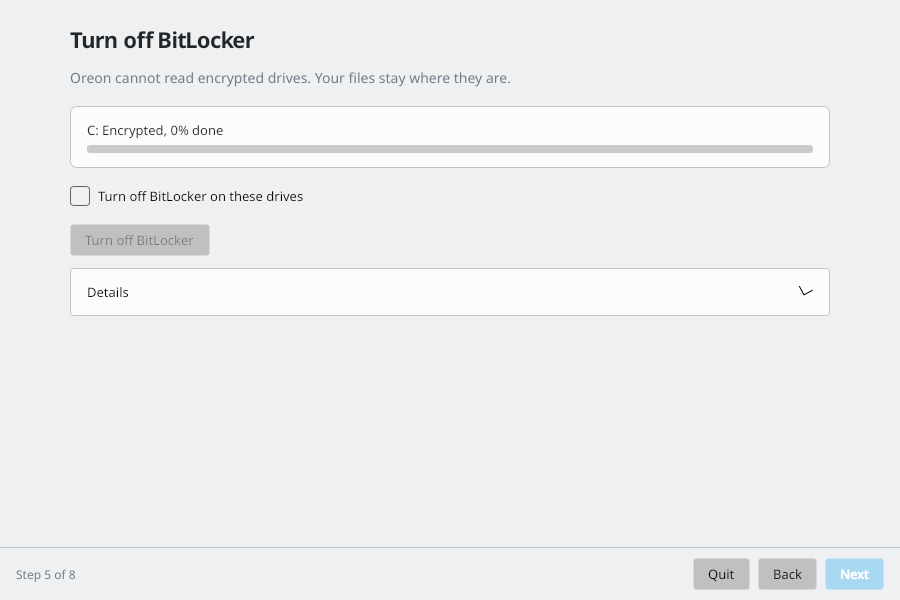

This page only shows if a drive is encrypted. Oreon cannot read encrypted drives. Click Turn off BitLocker. It takes about 5 to 20 minutes per 100 GB and keeps going if you close the app.

### Summary

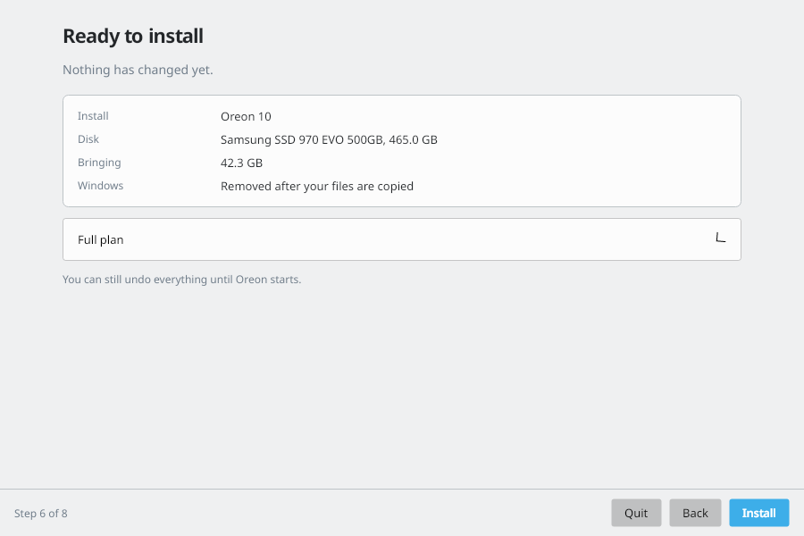

This is the full plan: how much C: shrinks, the new /boot and root partitions, and what happens after restart. Click Save to Desktop to keep a copy. Nothing changes until you confirm.

### Installing

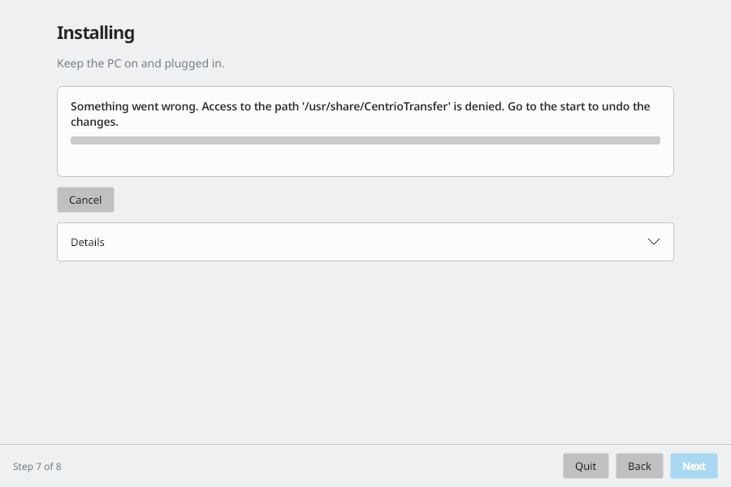

The app downloads and checks Oreon, shrinks C:, creates the Oreon partitions, writes Oreon, and adds Oreon to startup. Keep the PC on and plugged in. Everything up to here can be undone.

### Ready to install

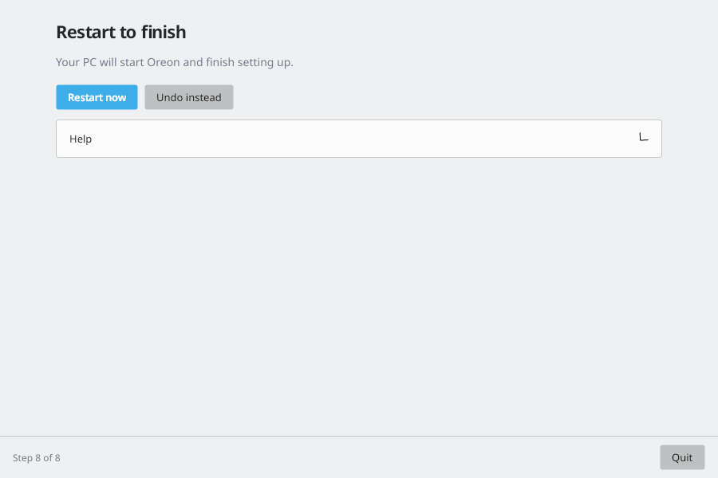

Click Restart now. You can still undo everything until Oreon starts.

## 5. What happens after restart

NOTE: things may take a while, do not panic and reboot or mess with things!!!
ANOTHER NOTE: sometimes notifications will pop up with the progress, sometimes it may look stuck, but actually has completed, the solution is to clear the notification via the X.

1. The PC starts Oreon 10. If Windows starts again, open the boot menu with F12, F9 or Esc and choose Oreon 10.
2. Oreon finishes setting itself up.
3. GNOME first-time setup opens. Create your account.
4. As soon as you reach the desktop, a notice says "Setup is still finishing". It shows how far the copy of your files from Windows has got, for example "Copying your files from Windows. 40%". Leave the PC on and plugged in. If the PC restarts or loses power during this step, the copy starts again on its own after you log in.
5. When the copy is checked, the notice changes to "Restarting to remove Windows" with a countdown from 2 minutes. Save your work. Click Restart now if you do not want to wait. If you restart the PC yourself, removing Windows still goes ahead on the next start.
6. Before the login screen you see a text screen like this:

   `Finishing setup. Please do not turn off your PC. Removing Windows. 40%`

   and then

   `Finishing setup. Please do not turn off your PC. Moving your files. 45%`

   This can take a long time if you brought a lot of files. The number goes up as it works. Do not turn off the PC or hold the power button. The screen is not frozen.
7. The login screen appears. A notice says "Windows removed". The old Windows space is now your /home partition.
8. If you picked apps to bring, they are installed from Flathub now. The notice shows "Installing apps" with a percent. You can use the PC while this runs. When it is done you get "Apps installed", or a list of the apps that could not be installed. You can get those later from Software.

In rare cases you get "Restart to finish removing Windows". Restart once more and Oreon finishes setting up /home.

If the power goes out during step 6, turn the PC back on. It carries on from where it stopped.

## 6. If Windows is kept

Windows is only deleted after your files are copied and checked. If something fails, you get a "Windows was kept" notice and Windows stays on the disk. Details are in `/var/lib/centrio-transfer/log`.

## 7. Undo

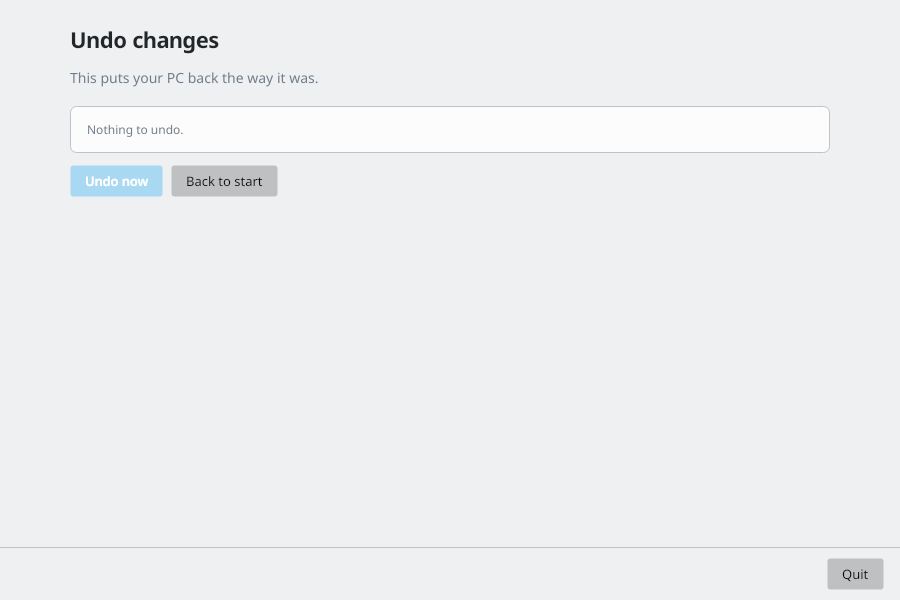

Before Oreon starts for the first time, open Centrio Transfer in Windows and click Undo changes. It removes the Oreon startup entry, the Oreon partitions and the download, gives C: its space back and turns Fast Startup back on if the app turned it off. After Windows is deleted there is nothing to undo.

## 8. Troubleshooting

- Checks fail with legacy BIOS or MBR: convert the disk with `mbr2gpt /convert /allowFullOS`, then switch the firmware to UEFI and turn off CSM.
- Storage mode is RAID: in Windows run `bcdedit /set {current} safeboot minimal`, set the storage mode to AHCI in the firmware, start Windows, then run `bcdedit /deletevalue {current} safeboot`.
- Not enough room: free space on C: or unselect items on the What to bring page.
- The PC starts Windows instead of Oreon: use the boot menu (F12, F9 or Esc) and pick Oreon 10. Oreon puts itself first again on the next start.
- Emergency shell after a forced power off: start the PC again and let it finish. If it still stops, the logs are in `/var/lib/centrio-transfer/log` and the /home line in `/etc/fstab` uses `nofail`, so the PC can still start without it.
- I cannot find my desktop items: look in the files app in the Desktop folder. Icons are not listed on the desktop itself.
